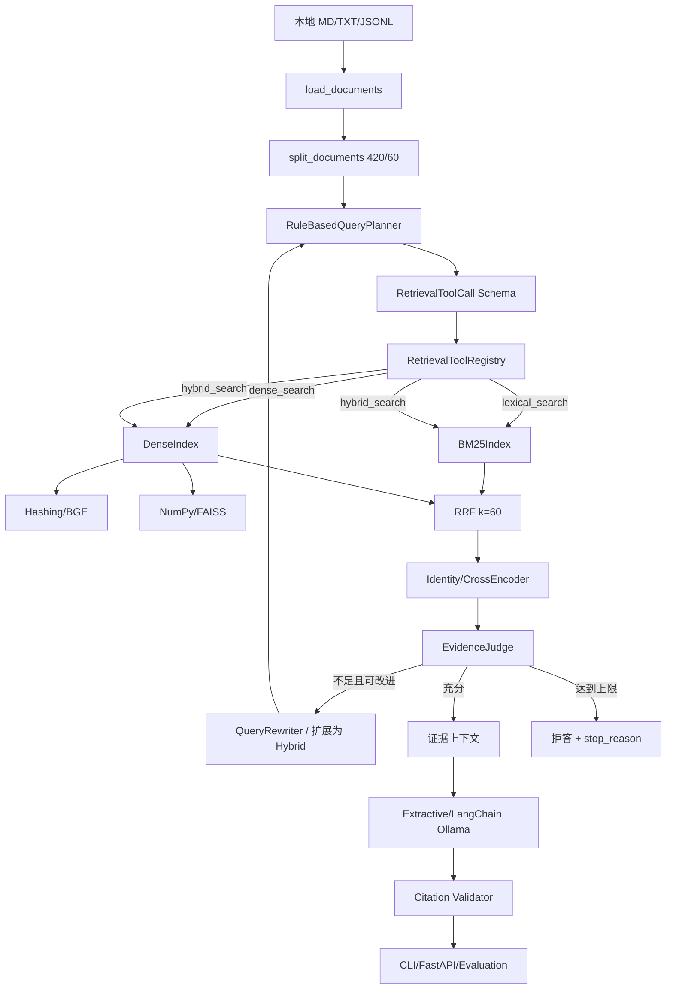

# 架构说明

## 组件边界



## Agent 控制边界

默认控制器是离线确定性策略，而不是自由调用工具的通用 LLM Agent。首轮根据错误码、版本号、文件名和路径等精确信号选择 `lexical_search`，根据“原理、含义、区别”等语义型问题选择 `dense_search`，其余问题选择 `hybrid_search`。每次调用通过 `RetrievalToolCall` 校验工具名、query 与 top_k，再由注册器执行。首轮证据不足时，控制器清理问句并把第二轮扩展为 Hybrid；默认最多两轮，随后必须回答或拒答。

`agent_trace` 记录每轮 query、route、tool_name、tool_arguments、latency_ms、evidence_count、evidence_ids、reason 和 action，`stop_reason` 记录 `evidence_sufficient`、`query_could_not_be_improved` 或 `max_iterations_reached`。精确标识符约束跨两轮保留，并同时检查正文与 source 元数据，避免 Hybrid 重试用无关稠密证据回答不存在的错误码或文件名。

## 可追溯证据

每个 Chunk 保存 `chunk_id`、`source`、`start`、`end` 和原文。ID 使用来源、起止位置与内容的 SHA-256 前 16 位，因此相同输入和切片参数会得到相同 ID。生成阶段收到的上下文格式为：

```text
[chunk_id] source:start-end
原始片段
```

证据块使用专用分隔符 `<<<EVIDENCE>>>`，不能使用普通空行。早期实现按空行拆分，Markdown 标题与正文之间的空行导致生成器只输出标题，烟测表现为检索指标和引用有效率正常、术语覆盖率为 0；回归测试已覆盖该故障。

## 后端真实性

- 最小依赖环境：BM25 + Hashing Embedding + NumPy 点积 + Identity Reranker + Extractive Generator。
- 安装 `faiss-cpu` 且成功创建 `IndexFlatIP` 后，稠密后端才报告 `faiss`。
- BGE-M3 与 CrossEncoder 都延迟加载，并检查形状、数量与非有限值。
- LangChain/Ollama 只在选择 `--generator ollama` 时导入。
- FastAPI 只在调用 `create_app()` 时导入。

这种设计让默认测试不依赖网络，同时避免把未运行的模型链路写成已经验证。

2026-08-15 的正式模型实跑使用 BGE-M3、FAISS、`bge-reranker-v2-m3` 和离线抽取式生成器，后端字符串完整记录了这四段状态。缓存完成后可通过 `--local-files-only` 禁止 Hugging Face 启动检查，从而在无网络环境复跑。
